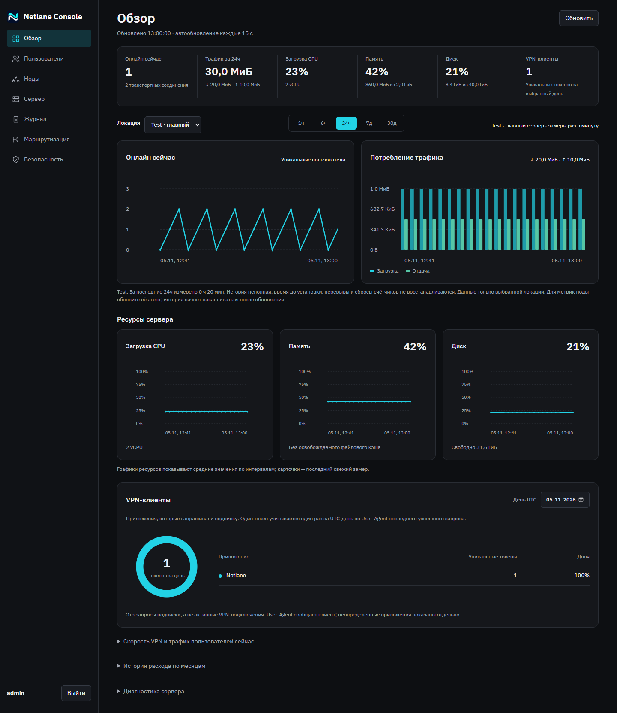

<p align="center"></p>

# Netlane Server

Свой VPN на базе [TrustTunnel](https://github.com/TrustTunnel/TrustTunnel): веб-панель, пользователи и ноды в нескольких локациях.

[](https://github.com/divezh/netlane-server/releases/latest)
[](https://github.com/divezh/netlane-server/actions/workflows/ci.yml)


[Документация](docs/README.md) · Клиенты: [Windows](https://github.com/divezh/netlane-windows) · [macOS](https://github.com/divezh/netlane-macos)



## Возможности

- Пользователи, сроки доступа, лимиты скорости и трафика, группы локаций.
- Ноды в других странах и одна подписка на все локации.
- Общие правила маршрутизации (сайты и приложения) и DNS для клиентов.
- Дашборды: онлайн, трафик, CPU, память, диск.
- HTTP/2, HTTP/3 (QUIC), Anti-DPI; HTTPS, 2FA, Fail2ban, ежедневные резервные копии.
- Обновление кнопкой в панели из последнего релиза этого репозитория.

Go + SQLite + systemd; Docker и Node.js не нужны.

## Установка

Чистый VPS x86_64 (Ubuntu 24.04 LTS, Ubuntu 26.04 или Debian 13), root, домен с A-записью на сервер, от 1 ГБ RAM. [Подробнее](docs/INSTALLATION.md).

```bash
cd /root
curl -fsSLO https://github.com/divezh/netlane-server/releases/latest/download/trusttunnel-dev.tar.gz
curl -fsSLO https://github.com/divezh/netlane-server/releases/latest/download/trusttunnel-dev.tar.gz.sha256
sha256sum -c trusttunnel-dev.tar.gz.sha256 &&
mkdir -p netlane-install && tar -xzf trusttunnel-dev.tar.gz -C netlane-install &&
bash netlane-install/setup.sh
```

Мастер выдаст адрес панели и данные входа. Включите 2FA и создайте пользователя. Ноду в другой локации добавляют через «Ноды → Добавить ноду»: панель покажет готовую команду. [Ноды и подписка](docs/NODES.md).

## Обновление

Раздел «Сервер» → «Обновление панели» → «Обновить», или по SSH:

```bash
sudo netlane-update            # проверить, спросить и установить последний релиз
sudo netlane-update --check    # только проверить
```

Обновляйте главный сервер и каждую ноду. Перед установкой делается резервная копия; если службы не поднялись, возвращается прежняя версия. `setup.sh` для обновления не используйте. [Подробнее](docs/UPDATES.md).

## Полезные команды

```bash
systemctl status trusttunnel-admin trusttunnel-managed          # панель и VPN
journalctl -u trusttunnel-admin -u trusttunnel-update -n 100     # журнал панели и обновлений
systemctl start trusttunnel-backup.service                       # резервная копия сейчас
ls /var/backups/trusttunnel                                      # резервные копии (14 последних)
bash netlane-install/setup.sh --resume                           # продолжить прерванную установку
```

Храните резервные копии вне VPS: в них ключи и конфигурация. [Восстановление установки](docs/INSTALLER-RECOVERY.md).

## Разработка

[Сборка и тесты](docs/DEVELOPMENT.md) · [Архитектура](docs/ARCHITECTURE.md) · [HTTP API](docs/API.md) · [Изменения](CHANGELOG.md) · [Внесение изменений](CONTRIBUTING.md) · [Безопасность](SECURITY.md)

Выпуск: раздел версии в `CHANGELOG.md`, затем Actions → Release с тегом `netlane-X.Y.Z`.

Проект независим от разработчиков TrustTunnel.
