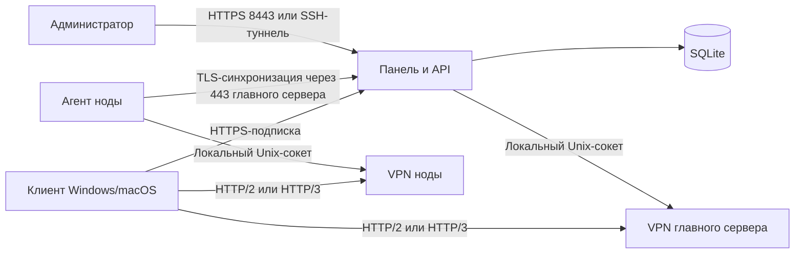

# Архитектура

Netlane объединяет панель управления, управляемый VPN endpoint и клиенты для Windows и macOS. Главный сервер хранит пользователей; ноды получают подтверждённые изменения и обслуживают VPN в своих локациях.

Стрелки подписки и синхронизации показывают логическую связь: эти запросы принимает сайт-маскировка главного сервера на 443 и передаёт встроенному обработчику. Нода не открывает административный порт.

## Компоненты

| Каталог | Назначение |
| --- | --- |
| `cmd/trusttunnel-admin/` | CLI панели, установочная и диагностическая команды, агент ноды |
| `internal/api/` | HTTP API, авторизация/2FA, профили и подписки, синхронизация |
| `internal/store/` | SQLite, шифрование credentials, политики и история статистики |
| `internal/endpoint/` | Управляющий сокет и метрики VPN |
| `internal/node/`, `internal/hoststats/` | Синхронизация и ресурсы нод/главного сервера |
| `web/` | Рабочий веб-интерфейс, встраивается в Go-бинарник |
| `upstream/` | Закреплённые исходники и патчи TrustTunnel; лицензия upstream |
| `deploy/` | systemd, резервные копии, Fail2ban, пакеты и тестовые образы |
| `scripts/` | Установка, обновление, локальная сборка и интеграционные проверки |
| `design/`, `decoy/` | Изолированные демо-экраны и сайт-маскировка |
| `docs/` | Инструкции и контракты |

`artifacts/`, `research/`, `.tools/` и рабочие данные локальны и не входят в Git. Клиенты — в отдельных репозиториях [netlane-windows](https://github.com/divezh/netlane-windows) и [netlane-macos](https://github.com/divezh/netlane-macos).

## Данные и совместимость

Панель сохраняет желаемую политику и отдельно отмечает подтверждённую endpoint ревизию. Ограничения скорости, срока и квоты применяет сам endpoint. Ноды получают подтверждённый список и продолжают работать с последним состоянием при временной недоступности главного сервера.

Ресурсы и трафик хранятся раздельно по локациям. Общая месячная квота при наличии нод пока не поддерживается. В Windows серверы, правила и DNS передаются через подписку; личные настройки сохраняются. Группы связывают пользователей с локациями: у пользователя одна группа, нода получает только пользователей своих групп, а группа без локаций покрывает всё. Подробности: [ноды и группы](NODES.md), [статистика](STATISTICS.md), [квоты](QUOTAS.md), [управляющий API](CONTROL.md).
